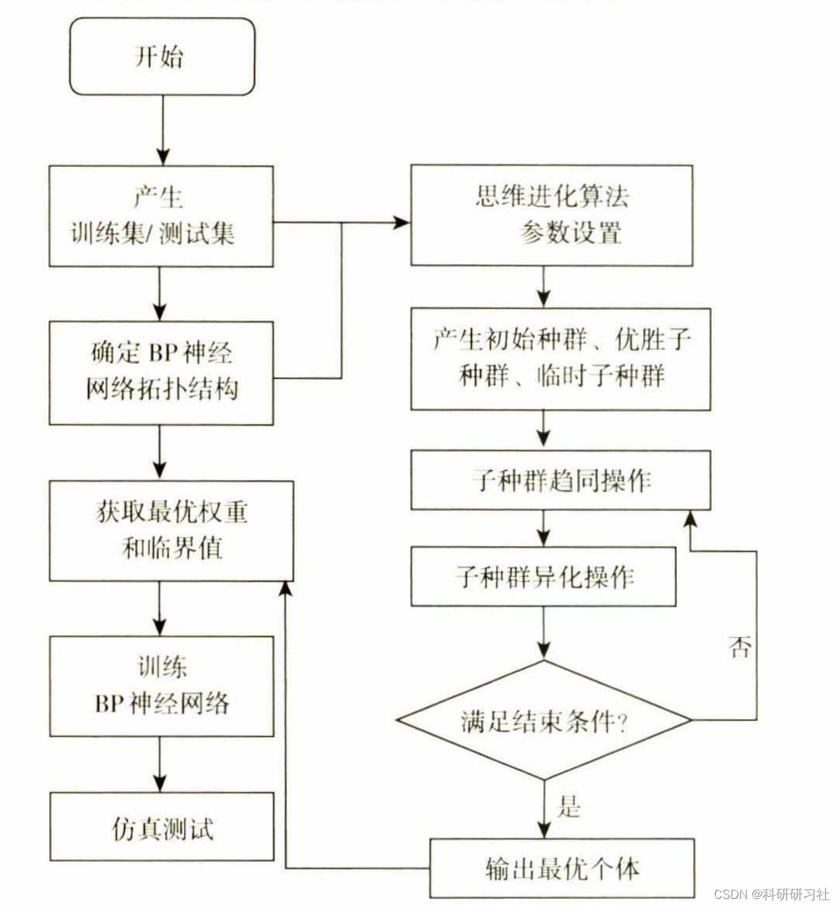

# [Return Prediction - BP Prediction]Optimizing the Application of BP Neural Network in Nonlinear Function Fitting Based on Evolutionary Computation Algorithm (Matlab Code Implementation)

1. Overview
As the project becomes increasingly complex and diverse, there may be a need to perform function fitting on a large amount of collected data during certain implementation stages. However, these data are nonlinear, and according to current traditional fitting methods, it is difficult to achieve the required fitting accuracy as per the project specifications.
Using traditional BP neural networks to directly predict and fit the changes in nonlinear functions has several shortcomings, such as slow convergence towards its limit, and low prediction and fitting accuracy. In response to the strengths and weaknesses of BP neural networks, this paper describes an algorithm that describes a theoretically strong nonlinear thinking process and evolution, adjusting its initial weights and critical values appropriately to make it easier to achieve optimization. By constructing a topological structure from this thought evolution algorithm and model, we use the optimal solution from the thought evolution algorithm to replace its initial weights and critical values. We select multiple nonlinear functions and conduct fitting simulation experiments using MATLAB. After comparing the differences between optimized and unoptimized results, through continuous analysis and summarization of experimental results, we can conclude that the B neural network's speed converges faster after optimization.
2. BP Neural Network
The execution order of the BP algorithm can be summarized as follows:
(1) Set initial weights for the network, which involves placing non-zero random numbers on each layer's weights.
(2) Input a data sample and its corresponding target output.
(3) Calculate the actual output of each layer based on the weights.
(4) Calculate the predicted error between the actual output values and the target output values.
(5) Multiple times change the network's weights and critical values to gradually approach the minimum error.
(6) Once all layers' weights are determined, determine whether to continue adjusting the weights based on the given end condition. If it meets the conditions, stop the algorithm; otherwise, return to step (3)-(6).
Other blogs also have related summaries:
[BP Prediction]BP Neural Network Data Regression Prediction Optimized by Genetic Algorithm (Matlab Code Realization)
1. Implementation of data prediction based on the Emperor Penguin algorithm optimized BP neural network (Matlab code implementation)
2. Research on neural network prediction based on cultural algorithms optimized (Matlab code implementation)
3. Basic idea of the Thinking Evolution Algorithm:
(1) By random functions, obtain the required number of individuals to distribute them evenly throughout the entire solution space.
(2) According to the scoring function, calculate the scores for all individuals and then select a subset of the highest-scoring individuals. These selected individuals are centered around themselves and generate a certain number of new individuals around them, forming a subpopulation. This subpopulation is then split into a winning subpopulation and a temporary subpopulation.
(3) Conduct convergence operations within each subpopulation, allowing them to compete with each other, ultimately identifying the winning individual and recording their score as the final score.
(4) Differentiation operations are implemented throughout the entire solution space. If there exists a mature temporary winning subpopulation with a lower score than another winning subpopulation, it is replaced by this winning subpopulation; if a mature temporary subpopulation has a lower score than any winning subpopulation, it is discarded. All individuals in the replaced or discarded subpopulations will be scattered again throughout the solution space, forming a new temporary subpopulation.
4. Steps to optimize BP neural network using the Thinking Evolution Algorithm:
5. Matlab code and detailed article reading: This article only showcases part of the code, and all codes and articles can be found in:
function initpop = initpop_generate(popsize,S1,S2,S3,S4,P,T,Pt,Tt)
6. References [1] Wang Yongliang. Evolutionary Algorithm Optimization of BP Neural Network for Nonlinear Function Fitting Applications [J]. Xinzhou Normal University Journal, 2021, 37(05):35-41.

## Images

<!-- PAYMENT_BLOCK -->

## Get this dataset

- Payment link (Stripe): [Buy now](https://buy.stripe.com/3cs8yP7sY87d0vu9AB)
- Payment QR code: 

<!-- /PAYMENT_BLOCK -->
